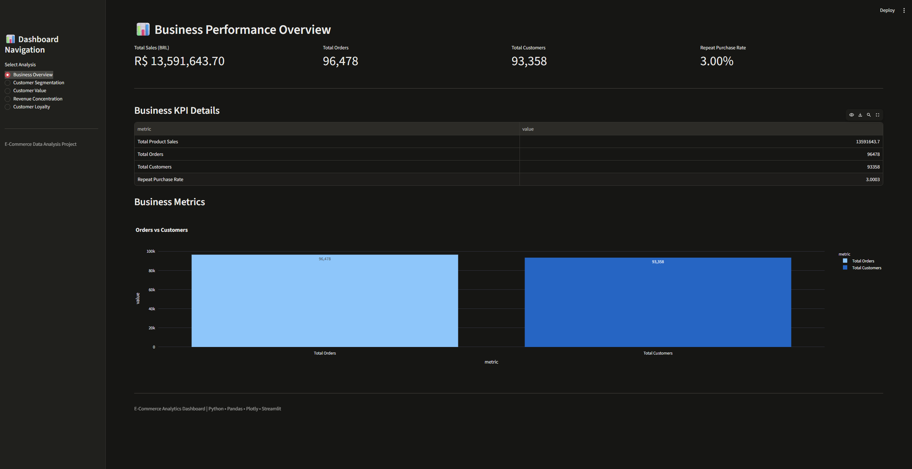
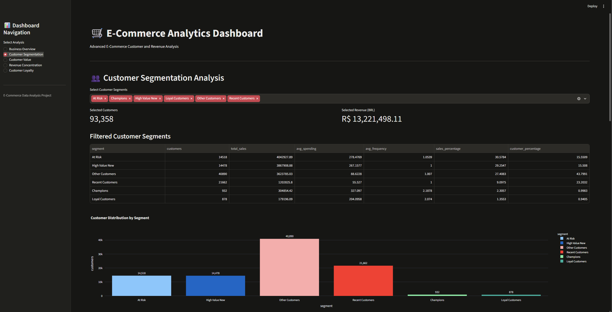
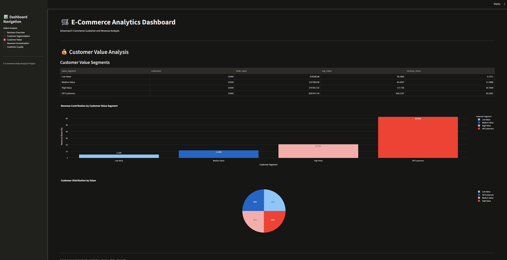
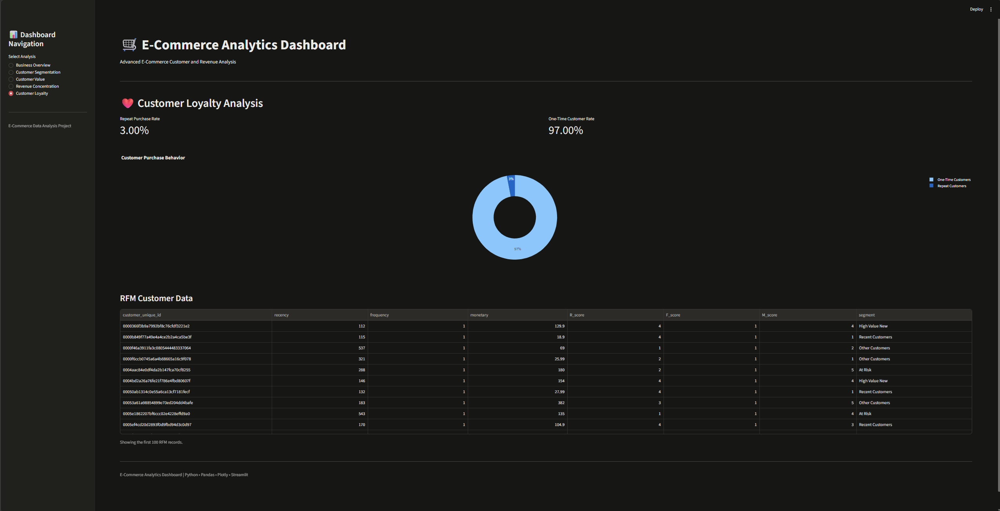

# 🛒 E-Commerce Data Analysis | Advanced Python Analytics Project

**Python · Pandas · RFM Analysis · Customer Analytics · Plotly · Streamlit · GitHub**

## Project Overview

This project presents an end-to-end E-Commerce Data Analysis workflow using the **Olist Brazilian E-Commerce Dataset**.

The objective is to analyze business performance, understand customer purchasing behavior, identify revenue trends, evaluate customer retention, and translate analytical findings into actionable business insights.

The project combines data exploration, validation, customer segmentation, revenue analysis, time-series analysis, and an interactive Streamlit dashboard.

## Key Performance Indicators

| Business Metric | Result |
|---|---:|
| Total Product Sales — All Order Statuses | R$ 13,591,643.70 |
| Delivered Orders | 96,478 |
| Unique Customers | 93,358 |
| Repeat Purchase Rate | 3.00% |
| Average Purchase Frequency | 1.03 |
| Revenue Share — Top 20% of Customers | 56.62% |
| Revenue Share — VIP Customers | 62.53% |

**Methodological Note:** Total Product Sales includes all order statuses. Customer analytics, segmentation, and revenue concentration use delivered orders, with a corresponding revenue base of R$ 13,221,498.11.

## Technologies & Tools

- **Python:** Data analysis and processing
- **Pandas & NumPy:** Data cleaning, manipulation, and aggregation
- **Jupyter Notebook:** Exploratory analysis and reproducible workflows
- **Matplotlib & Seaborn:** Statistical visualizations
- **Plotly:** Interactive visualizations
- **Streamlit:** Interactive business intelligence dashboard
- **Git & GitHub:** Version control and project documentation

## Analytical Workstreams

### 1. Business Performance Analysis

Analysis of core business metrics, including total product sales, delivered orders, unique customers, and repeat purchase behavior.

### 2. Customer Segmentation — RFM Analysis

Customers are analyzed using the RFM framework:

- **Recency:** Time since the most recent purchase
- **Frequency:** Number of purchases
- **Monetary:** Total monetary value of purchases

RFM analysis supports customer profiling and targeted retention strategies.

### 3. Customer Value Analysis

Customers are classified into four value groups:

- Low Value
- Medium Value
- High Value
- VIP Customers

The VIP segment includes 23,340 customers and accounts for approximately 62.53% of revenue within the customer value analysis.

### 4. Revenue Concentration — Pareto Analysis

Revenue concentration analysis evaluates the contribution of different customer groups.

| Customer Group | Revenue Share |
|---|---:|
| Top 1% | 11.47% |
| Top 5% | 29.13% |
| Top 10% | 41.10% |
| Top 20% | 56.62% |
| Top 50% | 83.31% |

### 5. Customer Loyalty Analysis

Customer loyalty analysis examines one-time versus repeat customers.

| Customer Type | Customers |
|---|---:|
| One-Time Customers | 90,557 |
| Repeat Customers | 2,801 |

The repeat purchase rate of approximately 3.00% highlights an opportunity to investigate customer retention strategies.

### 6. Sales Trends Analysis

Monthly sales analysis evaluates revenue trends, order volumes, and revenue growth using Month-over-Month (MoM) and Year-over-Year (YoY) comparisons.

**Key findings:**

- Highest revenue month: November 2017 — R$ 987,765.37
- January–August 2017 revenue: R$ 2,993,456.13
- January–August 2018 revenue: R$ 7,218,125.12
- Revenue growth across these eight comparable months: approximately 141.13%

Because 2018 is not a complete calendar year in the dataset, the comparison uses matching months rather than full-year totals.

The analysis also identifies low-activity months and distinguishes standard YoY comparisons from comparisons affected by a low base or missing historical data.

## Interactive Streamlit Dashboard

The project includes six interactive analytical pages:

1. **Business Overview** — Core KPIs and business performance
2. **Customer Segmentation** — RFM-based customer analysis
3. **Customer Value** — Customer value groups and revenue contribution
4. **Revenue Concentration** — Revenue distribution and Pareto analysis
5. **Customer Loyalty** — One-time and repeat purchasing behavior
6. **Sales Trends** — Monthly trends, interactive year filters, MoM/YoY analysis, and automated business insights

### Dashboard Screenshots

#### Business Overview



#### Customer Segmentation



#### Customer Value



#### Revenue Concentration


#### Customer Loyalty



#### Sales Trends

The Sales Trends dashboard includes monthly revenue and order charts, year-over-year revenue comparisons, interactive year filtering, and automated business insights.

*A Sales Trends screenshot can be added here once saved in the images directory.*

## Project Structure

```text
Ecommerce-Data-Analysis/
│
├── DATA/
│   ├── RAW/
│   └── processed/
│
├── dashboard/
│   └── app.py
│
├── notebooks/
│   ├── 01_Data_Exploration.ipynb
│   └── 02_Sales_Trend_Analysis.ipynb
│
├── images/
│
├── reports/
│   ├── 02_Data_Validation_Report.md
│   ├── 03_Project_Summary.md
│   └── Executive_Summary.md
│
├── README.md
├── requirements.txt
└── .gitignore
```

## How to Run the Project

### 1. Clone the Repository

```bash
git clone https://github.com/mohammedabualkam88-eng/Ecommerce-Data-Analysis.git
cd Ecommerce-Data-Analysis
```

### 2. Create a Virtual Environment

On Windows PowerShell:

```powershell
python -m venv .venv
.\.venv\Scripts\Activate.ps1
```

### 3. Install Dependencies

```powershell
python -m pip install -r requirements.txt
```

### 4. Launch the Dashboard

```powershell
python -m streamlit run dashboard/app.py
```

The dashboard will normally be available at:

http://localhost:8501

**Data requirement:** The dashboard reads processed CSV files from `DATA/processed`. These files must be available before launching the application.

## Reports & Documentation

- [Executive Business Summary — Hebrew](reports/Executive_Summary.md)
- [Data Validation Report](reports/02_Data_Validation_Report.md)
- [Project Summary](reports/03_Project_Summary.md)
- [Data Exploration Notebook](notebooks/01_Data_Exploration.ipynb)
- [Sales Trend Analysis Notebook](notebooks/02_Sales_Trend_Analysis.ipynb)

## Business Recommendations

The analysis suggests several areas for further business investigation:

- Improve customer retention by testing second-purchase campaigns.
- Develop targeted engagement strategies for high-value customers.
- Monitor revenue and order trends through monthly performance dashboards.
- Investigate seasonal sales patterns and the November 2017 revenue peak.
- Standardize revenue definitions and account for incomplete or low-activity periods when comparing performance.

These recommendations are analytical hypotheses that should be validated through further testing.

## Dataset

**Source:** Olist Brazilian E-Commerce Dataset

The original CSV files are stored locally in `DATA/RAW` and are not included in the GitHub repository.

## Project Purpose

This project demonstrates practical skills in:

- Data cleaning and validation
- Exploratory Data Analysis (EDA)
- Customer segmentation and RFM modeling
- Revenue and customer value analysis
- Time-series analysis
- Interactive dashboard development
- Business reporting and data storytelling
- Git and GitHub version control

**Project Focus:** Turning e-commerce data into meaningful business insights using Python.