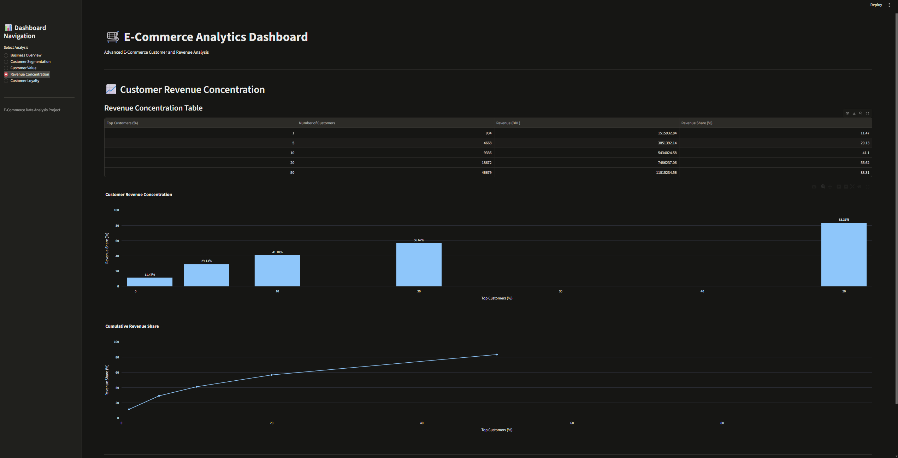

# ניתוח נתוני מסחר אלקטרוני | E-Commerce Data Analysis
**פרויקט Data Science מתקדם | Python · Pandas · RFM Analysis · Streamlit**

פרויקט מקיף לניתוח נתוני מסחר אלקטרוני, המבוסס על **Olist Brazilian E-Commerce Dataset**. הפרויקט משלב עיבוד וניתוח נתונים, מדדי ביצוע עסקיים (KPIs), פילוח לקוחות, ניתוח ערך לקוח, ריכוז הכנסות ובחינת נאמנות לקוחות.

ממצאי הניתוח מוצגים באמצעות **Streamlit Dashboard** אינטראקטיבי, המאפשר בחינה ויזואלית של ביצועי העסק והתנהגות הלקוחות.

## תוצאות מרכזיות | Key Performance Indicators

| מדד | תוצאה |
|---|---|
| סך מכירות המוצרים — כלל ההזמנות | R$ 13,591,643.70 |
| מספר הזמנות שסופקו | 96,478 |
| מספר לקוחות ייחודיים | 93,358 |
| שיעור לקוחות חוזרים | 3.00% |
| תדירות רכישה ממוצעת | 1.03 |
| חלקם של 20% הלקוחות המובילים בהכנסות מהזמנות שסופקו | 56.62% |
| חלקם של לקוחות VIP בהכנסות מהזמנות שסופקו | 62.53% |

**הערה מתודולוגית:** נתון המכירות הכולל מתייחס לכל סטטוסי ההזמנות. ניתוחי הלקוחות, הפילוח וריכוז ההכנסות מבוססים על הזמנות שסופקו, בהיקף מכירות של R$ 13,221,498.11.

---


## סקירת הפרויקט

פרויקט Data Analysis מתקדם המבוסס על Olist Brazilian E-Commerce Dataset, במטרה לנתח ביצועים עסקיים, התנהגות לקוחות, הכנסות ונאמנות לקוחות באמצעות Python.

הפרויקט כולל תהליכי Data Exploration, Data Validation, Customer Segmentation, RFM Analysis וניתוח ריכוז הכנסות, לצד Dashboard אינטראקטיבי שפותח באמצעות Streamlit.

## טכנולוגיות וכלים

- Python
- Pandas ו-NumPy
- Jupyter Notebook
- Matplotlib ו-Seaborn
- Plotly
- Streamlit
- Git ו-GitHub

## מדדים עסקיים מרכזיים

| מדד | תוצאה |
|---|---:|
| מספר הזמנות שסופקו | 96,478 |
| מספר לקוחות ייחודיים | 93,358 |
| סך מכירות מוצרים — כלל ההזמנות | R$ 13,591,643.70 |
| שיעור רכישה חוזרת | 3.00% |
| תדירות רכישה ממוצעת | 1.03 |

## ניתוחים מרכזיים

### Customer Segmentation

פילוח לקוחות באמצעות מודל RFM, המבוסס על Recency, Frequency ו-Monetary.

### Customer Value

חלוקת לקוחות לארבע קבוצות ערך: Low Value, Medium Value, High Value ו-VIP Customers.

### Revenue Concentration

ניתוח התפלגות ההכנסות בין קבוצות לקוחות וזיהוי ריכוז ההכנסות.

### Customer Loyalty

בחינת לקוחות שרכשו פעם אחת לעומת לקוחות חוזרים, לצורך זיהוי הזדמנויות לשיפור שימור הלקוחות.

## Dashboard

הפרויקט כולל Dashboard אינטראקטיבי המציג חמישה תחומי ניתוח:

1. Business Overview
2. Customer Segmentation
3. Customer Value
4. Revenue Concentration
5. Customer Loyalty

## הרצת הפרויקט

התקנת הספריות:

```bash
pip install -r requirements.txt
```

הפעלת לוח המחוונים:

```bash
streamlit run dashboard/app.py
```
### צילומי מסך של לוח המחוונים | Dashboard Screenshots

להלן תצוגה של חמשת תחומי הניתוח המרכזיים בפרויקט.

#### Business Overview

סקירה של מדדי הביצוע העסקיים המרכזיים.


#### Customer Segmentation

פילוח לקוחות באמצעות מודל RFM וניתוח קבוצות לקוחות.


#### Customer Value

ניתוח ערך הלקוחות ותרומת קבוצות הלקוחות להכנסות.


#### Revenue Concentration

ניתוח ריכוז ההכנסות בקרב הלקוחות המובילים.



#### Customer Loyalty

ניתוח לקוחות חוזרים ושיעור הרכישה החוזרת.


## תיעוד נוסף

- `notebooks/01_Data_Exploration.ipynb` — מחברת ניתוח הנתונים.
- `notebooks/doc/01_Project_Documentation.md` — תיעוד הפרויקט.
- `reports/02_Data_Validation_Report.md` — דוח בדיקות איכות הנתונים.
- `reports/03_Project_Summary.md` — סיכום הפרויקט.

## מקור הנתונים

Olist Brazilian E-Commerce Dataset.

קובצי המקור נשמרים בתיקיית `DATA/RAW` ואינם נכללים במאגר GitHub.